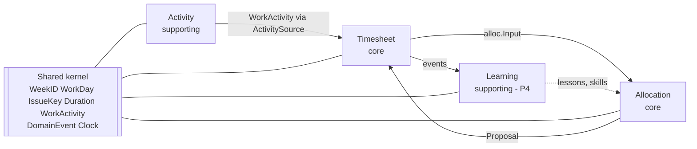
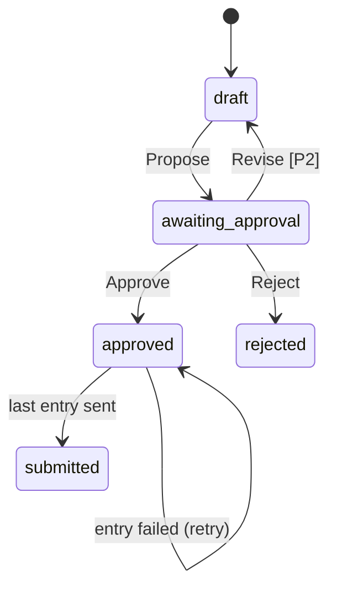

# Bounded contexts

Activity and Allocation have no direct relation. Timesheet application pulls the week's activity through its `ActivitySource` port and passes it to the policies in `alloc.Input`.

| Context | Package | Owns | Status |
|---|---|---|---|
| Shared kernel | `internal/shared/kernel` | Value objects, `WorkActivity` (published language: Activity produces it, Allocation reads it from `alloc.Input`), `DomainEvent`, `Clock` | [built] |
| Activity | `internal/activity` | Slack collector; `Source` port, unused apart from a compile-time assertion (open finding L7) | [built] |
| Allocation | `internal/allocation` | `Policy`, `Proposal`, `RulePolicy`; `grpcpolicy` adapter to `services/allocation-agent` (ADR-0007; replaces `claudeagent`) | rule [built], agent [planned: P3] |
| Timesheet | `internal/timesheet` | `Timesheet` aggregate, handlers, Postgres/Jira/Tempo adapters | [built] |
| Learning | `internal/learning` | `Feedback`, `Lesson`, `SkillProposal`; agent workspace | [planned: P4] |

## Integration rules

- Domain packages import only the kernel and their own context.
- Application packages may use another context's domain types (Timesheet application consumes `allocation/domain.Policy`).
- Contexts never share database tables.

## Timesheet lifecycle

- `draft` is never persisted: `ProposeHandler` builds the aggregate and calls `Propose` before it saves, so the first stored state is `awaiting_approval`.
- `rejected` has no exit. To re-plan, run `plan --force`: it deletes the stored timesheet and saves a new aggregate (see open finding H1 in [project-structure.md](project-structure.md#conformance-review-2026-10-09)).
