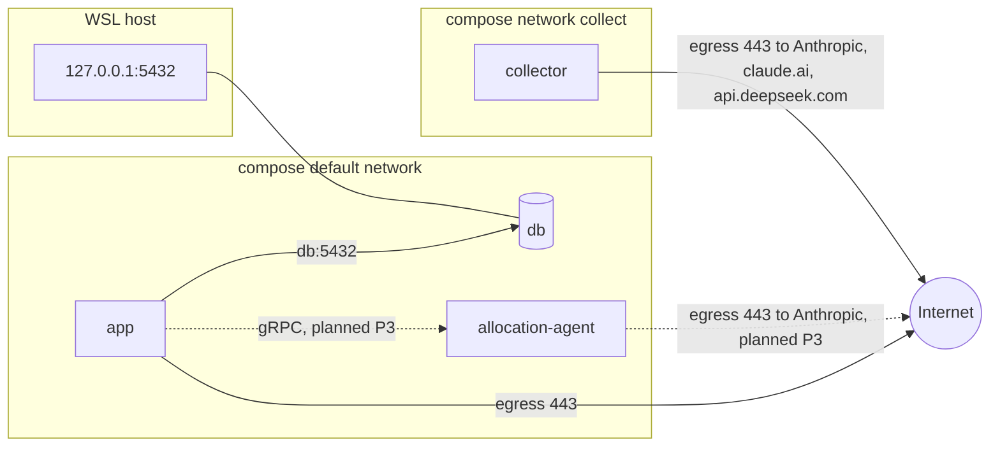

# Network

Owned by `networking-engineer`. The process makes outbound connections only; nothing listens on a public interface.

## Egress

| Destination | Protocol | Purpose | Auth | Status |
|---|---|---|---|---|
| `slack.com` (Web API) | HTTPS 443 | `search.messages` | user token `xoxp-` | built |
| `slack.com` Socket Mode | WSS 443 | approval button events | app token `xapp-` | planned: P2 |
| `<site>.atlassian.net` | HTTPS 443 | issue lookup | basic `email:api_token` | built |
| `api[.eu|.us].tempo.io` | HTTPS 443 | create worklogs | bearer | built |
| `api.anthropic.com` | HTTPS 443 | allocation agent; the call leaves from the allocation-agent container, not the Go core (ADR-0007) | `ANTHROPIC_API_KEY`, held only by the allocation-agent | planned P3, ADR-0007 |
| `api.anthropic.com`, `claude.ai` | HTTPS 443 | Slack activity collector (`collect`): the Claude Code session and the claude.ai Slack connector (ADR-0011) | the owner's claude.ai login; never an API key ([ADR-0013](../adr/0013-per-service-env-files.md)) | built (host-run); compose `collector` service has no login yet |
| `api.deepseek.com` | HTTPS 443 | collector LLM report parser, only when `report.parser` is `llm`; sends the report summaries to a third party (confirm company policy) | `DEEPSEEK_API_KEY`, from `services/allocation-agent/.env` only | in progress |
| `db:5432` (compose network) | TCP | Postgres | password (local only) | built |
| `allocation-agent` (compose network; port not yet chosen) | gRPC over HTTP/2 | `PolicyService.Allocate`, called by the Go core; internal only, no published port | not yet decided | planned P3, ADR-0007 |

## Current HTTP client settings

One shared client from `httpx.NewClient(30 * time.Second)` (`cmd/timesheet/wire.go`) wraps `http.DefaultTransport`, which sets `Proxy: ProxyFromEnvironment`, a 30s dial timeout, a 10s TLS handshake timeout, a 90s idle connection timeout and `MaxIdleConns: 100` (`go doc -src net/http.DefaultTransport`).

Known gaps for review:

- No response-header timeout on the transport; only the 30s overall client timeout bounds a slow server.
- `RetryTransport` retries non-idempotent POSTs on 5xx (coding-standards R3, K2): risk of duplicate Tempo worklogs.

## Compose network

- The `allocation-agent` gRPC service is planned P3 ([ADR-0007](../adr/0007-grpc-contracts-now-split-later.md)). `docker-compose.yml` does not define it yet.
- The `collector` service (profile `collect`, [ADR-0013](../adr/0013-per-service-env-files.md)) runs the Slack activity collector on its own `collect` network, with no route to `db`. It needs egress to Anthropic and claude.ai, and to `api.deepseek.com` when `report.parser` is `llm`. The network has no egress filter. Collection still runs on the host (`make collect`) until the container has a claude.ai login.
