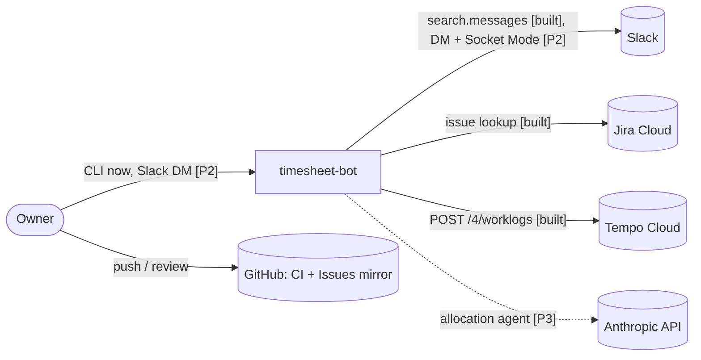
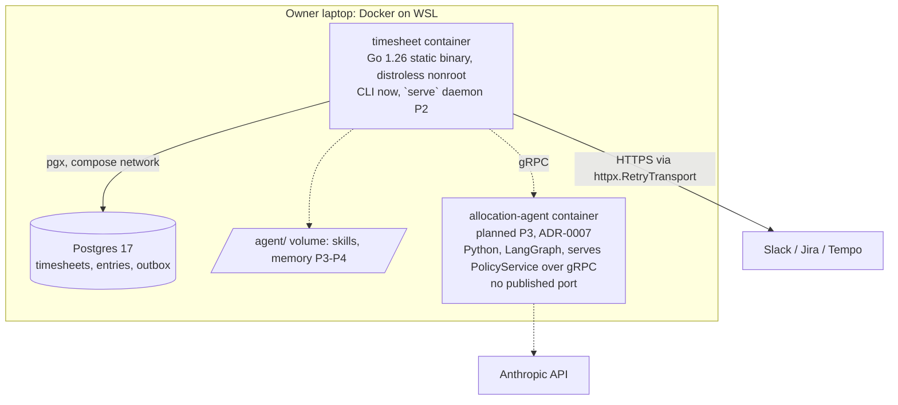
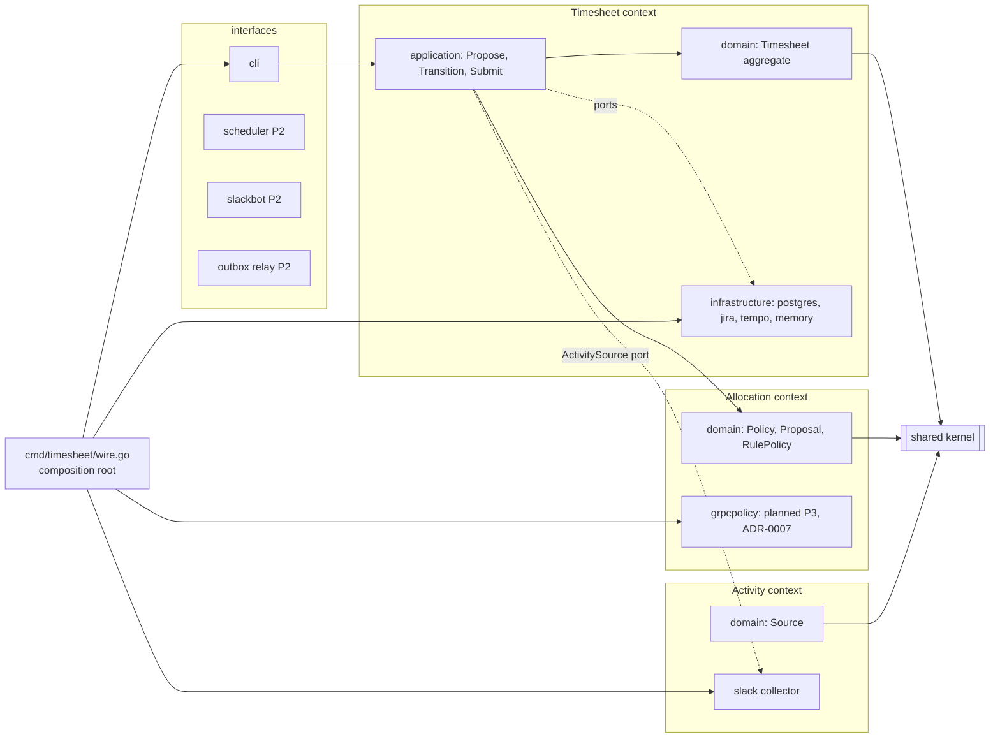
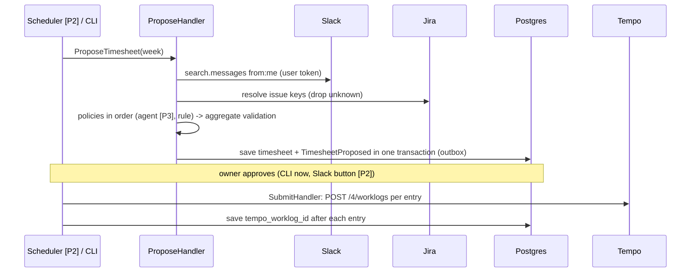

# System overview

Status legend: **[built]**, **[planned: Pn]**. Decisions: [ADRs](../adr/). Contexts: [bounded-contexts.md](bounded-contexts.md). Tests: [testing.md](testing.md). Network: [network.md](network.md). Growth: [scalability.md](scalability.md).

## Context (C4 level 1)

## Containers (C4 level 2)

Under ADR-0007 the Anthropic egress belongs to the allocation-agent container, not the Go core (planned P3). See [ADR-0007](../adr/0007-grpc-contracts-now-split-later.md) and [network.md](network.md).

## Components (C4 level 3)

Dependency rule: arrows point inward to the domain and kernel. It is enforced by the architecture tests in `test/architecture` ([ADR-0001](../adr/0001-ddd-package-by-bounded-context.md); tests moved out of `internal/` by [ADR-0009](../adr/0009-tests-in-separate-tree.md)).

## Weekly flow

## Deployment and delivery

| Concern | How |
|---|---|
| Runtime | `docker compose` on the laptop; Postgres bound to 127.0.0.1 |
| Build | multi-stage `golang:1.26.9-alpine` to `distroless/static-debian12:nonroot`, tzdata and migrations embedded ([ADR-0005](../adr/0005-go-1-26-and-embedded-assets.md)) |
| CI | GitHub Actions `ci.yml`: lint, race and integration tests against Postgres, govulncheck, image build; actions pinned to commit SHAs |
| Dependencies | Dependabot weekly for Go modules, Actions and Docker; latest-stable policy (tech-selection P12) |
| Quality gates | `make ci` plus `make test-int cover` matches CI; architecture tests; the `/sdlc` agent pipeline |

## Quality attributes

See [non-functional requirements](../requirements/non-functional.md), [threat model](../security/threat-model.md), and SLOs (`docs/operations/slo.md`, planned, owned by sre-engineer).
