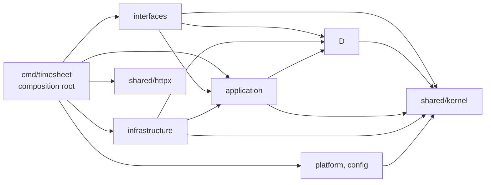

# Project structure

Every folder, what it holds, and which Clean Architecture layer it belongs to. Layer rules are enforced only partly by the architecture tests in `test/architecture` (`make arch`): the gaps are open findings M4, N1 and N2 in the [conformance review](#conformance-review-2026-10-09) and the [FE-001 open items](../backlog/epics/EP-001-weekly-timesheet-automation/features/FE-001-core-cli-timesheet/feature.md#open-items-before-closed). The flows that cross folders are in [code-map.md](code-map.md).

Layer legend: **D** domain, **A** application, **I** infrastructure (adapters), **E** entry points (interfaces), **C** composition root, **K** shared kernel, **P** platform and cross-cutting.

## Source tree

The layout (one folder per service under `services/`, an orchestration-only root, shared contracts in `api/proto/`) is decided in [ADR-0008](../adr/0008-monorepo-service-layout.md).

```text
timesheet-bot/                            monorepo root: no language tooling here
├── services/
│   ├── timesheet-core/                    Go service (built). Go paths in all docs are relative to this folder.
│   │   ├── go.mod, go.sum                    module `timesheet-bot`, Go 1.26, toolchain go1.26.9
│   │   ├── Makefile                          make ci = lint, test, race, vuln, build
│   │   ├── Dockerfile, .dockerignore         multi-stage build to distroless nonroot
│   │   ├── .env.example                      env template; .env (owner-only, gitignored) is this service's own (ADR-0013)
│   │   ├── .golangci.yml                     linters (naming, errors, security)
│   │   ├── config/config.example.yaml        non-secret settings template (config.yaml is gitignored)
│   │   ├── cmd/
│   │   │   └── timesheet/                     C  composition root: the only place that builds concrete adapters
│   │   │       ├── main.go                       signal handling, runs the CLI
│   │   │       └── wire.go                       config -> adapters -> handlers (cli.Factory)
│   │   │
│   │   ├── internal/
│   │   │   ├── shared/
│   │   │   │   ├── kernel/                    K  value objects shared by all contexts (published language)
│   │   │   │   │   ├── week.go                   WeekID (ISO week), Days, Contains, Prev
│   │   │   │   │   ├── workday.go                WorkDay (Mon-Fri date, timezone-free)
│   │   │   │   │   ├── issuekey.go               IssueKey + ExtractIssueKeys
│   │   │   │   │   ├── duration.go               Duration (positive multiple of 15m)
│   │   │   │   │   ├── activity.go               WorkActivity (evidence of work)
│   │   │   │   │   ├── clock.go                  Clock port + SystemClock
│   │   │   │   │   └── event.go                  DomainEvent interface
│   │   │   │   └── httpx/                     P  shared HTTP transport (retry, Retry-After); built only in cmd/timesheet/wire.go,
│   │   │   │                                     adapters receive the resulting *http.Client and never import httpx
│   │   │   │
│   │   │   ├── timesheet/                        Timesheet bounded context (core)
│   │   │   │   ├── domain/                    D  Timesheet aggregate, Entry, Status, events, errors, Repository port
│   │   │   │   ├── application/               A  ProposeHandler, TransitionHandler, SubmitHandler
│   │   │   │   │   └── ports.go                  ActivitySource, IssueDirectory, WorklogGateway (consumer-defined)
│   │   │   │   └── infrastructure/            I
│   │   │   │       ├── postgres/                 Repository + outbox (pgx), integration-tagged tests
│   │   │   │       ├── memory/                   Repository for tests; wire.go also installs it as a placeholder when
│   │   │   │                                     no database is needed (plan --dry-run), but a dry run never calls the
│   │   │   │                                     repository (application/propose.go:56, :101)
│   │   │   │       ├── jira/                     IssueDirectory over Jira Cloud REST v3
│   │   │   │       ├── mavenlink/                TimeEntryGateway over Mavenlink REST v1, bearer or cookie auth (ADR-0010)
│   │   │   │       └── tempo/                    WorklogGateway over Tempo REST v4
│   │   │   │
│   │   │   ├── allocation/                       Allocation bounded context (core)
│   │   │   │   ├── domain/                    D  Policy port, Proposal, Input, RulePolicy (scaleDay: owner TODO);
│   │   │   │   │                                 report.go: ReportLine, ReportParser port, ReportPolicy, DedupReportLines
│   │   │   │   └── infrastructure/
│   │   │   │       ├── reportparser/          I  ReportParser for the owner's Slack summaries (Parse: owner TODO, ADR-0012)
│   │   │   │       └── grpcpolicy/            I  planned P3 (ADR-0007): gRPC client to
│   │   │   │                                     allocation-agent, implements allocation.Policy;
│   │   │   │                                     anti-corruption layer from proto Proposal to domain Proposal
│   │   │   │
│   │   │   ├── learning/                         planned P4: Learning bounded context (feedback, lessons, skill proposals)
│   │   │   │   └── infrastructure/fsworkspace/ I  reads agent/ skills and prompts, writes agent/ memory
│   │   │   │
│   │   │   ├── activity/                         Activity bounded context (supporting)
│   │   │   │   ├── domain/                    D  Source port; Message + ToActivity, the one message-to-evidence mapping
│   │   │   │   └── infrastructure/
│   │   │   │       ├── file/                  I  week-file collector (activity.source: file), reads the allocation-agent's JSON
│   │   │   │       └── slack/                 I  Slack search.messages collector
│   │   │   │
│   │   │   ├── interfaces/
│   │   │   │   └── cli/                       E  cobra commands; call application handlers and render timesheet/domain
│   │   │   │                                     and kernel types (deliberately fine); never import infrastructure
│   │   │   │                                     planned P2: scheduler/, slackbot/, outbox/
│   │   │   │
│   │   │   ├── platform/
│   │   │   │   └── db/                        P  pgx pool and goose migrations runner
│   │   │   └── config/                        P  YAML config + environment secrets (names only in errors)
│   │   │
│   │   ├── migrations/                        P  goose SQL, embedded by its own embed.go (naming finding N-07)
│   │   │   ├── 00001_init.sql
│   │   │   └── embed.go
│   │   │
│   │   └── test/                                 every Go test, black-box (package x_test), outside internal/ and cmd/ (ADR-0009)
│   │       ├── README.md                         layout and the folder mapping rule
│   │       ├── unit/
│   │       │   ├── kernel/                       internal/shared/kernel
│   │       │   ├── allocation/domain/            internal/allocation/domain
│   │       │   ├── timesheet/domain/             internal/timesheet/domain
│   │       │   ├── timesheet/application/        internal/timesheet/application
│   │       │   ├── config/                       internal/config
│   │       │   ├── httpx/                        internal/shared/httpx
│   │       │   └── adapters/{jira,slack,tempo}/  the three API adapters
│   │       ├── integration/postgres/             //go:build integration; skipped unless TEST_DATABASE_URL is set
│   │       ├── architecture/                     fitness tests: dependency rule, no wall clock,
│   │       │                                     no production import of test/; partial, see M4, N1-N3
│   │       └── e2e/                              planned: end-to-end CLI tests of this service
│   │
│   └── allocation-agent/                  Python: the Slack activity collector `collect` (ADR-0011); planned P3 (ADR-0007): LangGraph service serving PolicyService
│       ├── Dockerfile, .dockerignore         collector image, uv + python:3.12-slim (compose service `collector`, ADR-0013)
│       ├── .env                              owner-only, gitignored: this service's env, loaded by make collect (ADR-0013)
│       └── README.md
│
├── api/
│   └── proto/timesheetbot/                planned: gRPC contracts at context boundaries (allocation/v1, activity/v1)
│
├── agent/                                 planned P3: agent DATA (prompts, skills, memory), mounted into allocation-agent and, for P4 memory writes, into app
├── data/activity/                         week files <ISO week>.json from the allocation-agent collector (gitignored; .gitkeep only)
├── docs/                                  product and engineering documentation
├── .claude/                               Claude Code agent team, skills, rules, hooks
├── .github/                               CI workflow (runs in services/timesheet-core), Dependabot
├── docker-compose.yml                     local runtime: db + app + collector (profile collect); each loads its service .env (+ allocation-agent in P3)
├── Makefile                               runs a target in every service: make ci, make test, ...
└── README.md, CLAUDE.md, CHANGELOG.md
```

Every test (`*_test.go`) lives under `services/timesheet-core/test/`, not beside the code it tests. This deviates from the Go convention by owner choice ([ADR-0009](../adr/0009-tests-in-separate-tree.md)); see [testing.md](testing.md). Cross-service end-to-end tests are planned at the repo root in `tests/e2e/` (Phase 3).

## The AI agent: code and data

| Part | Where | What |
|---|---|---|
| Code (Go side) | `services/timesheet-core/internal/allocation/infrastructure/grpcpolicy/` | A gRPC client adapter implementing `allocation.Policy`. Planned P3 (ADR-0007). |
| Code (agent) | `services/allocation-agent/` | Python + LangGraph service implementing `PolicyService`. Planned P3. |
| Former plan (replaced by ADR-0007, not built) | `internal/allocation/infrastructure/claudeagent/` | In-process Go agent from the design spec, replaced by the two rows above under [ADR-0007](../adr/0007-grpc-contracts-now-split-later.md). It was planned as an adapter implementing `allocation.Policy`, placed in the policy chain before `RulePolicy` ([ADR-0004](../adr/0004-allocation-policy-fallback-chain.md)) so that its output would be validated by the `Timesheet` aggregate like any other proposal. |
| Data | `agent/` | Prompts, skills and memory the code loads at run time. Kept outside the binary so skills and lessons change without a rebuild. |

LangGraph's official libraries exist only for Python and TypeScript (github.com/langchain-ai: `langgraph`, `langgraphjs`; checked 2026-10-09). The owner chose LangGraph, so the agent is a separate Python service behind a gRPC contract (ADR-0007) instead of Go code inside the core.

## Allowed dependencies



| From | May import | Must not import |
|---|---|---|
| `*/domain`, `shared/kernel` | stdlib, kernel, own context | other contexts' domain, infrastructure, `net`, `database/*`, `os/exec` |
| `*/application` | domain types (own and other contexts), kernel; `github.com/google/uuid` today (open finding N5) | infrastructure, interfaces, platform, cmd |
| `*/infrastructure` | application ports, domain, kernel, SDKs; an injected `*http.Client` (no adapter imports httpx) | interfaces, cmd |
| `interfaces/*` | application handlers, domain types, kernel | infrastructure |
| `cmd/timesheet` | everything, including `shared/httpx` (builds the one HTTP client) | - |
| `test/...` (every Go test, ADR-0009) | any production package under `internal/`, through its exported API only (`cmd/timesheet` is a `main` package and cannot be imported) | - (and no production package may import `test/...`; `test/architecture` enforces it) |

## Other top-level folders

| Folder | Contents |
|---|---|
| `docs/` | Product and engineering documentation; index in [docs/README.md](../README.md) |
| `.claude/` | Claude Code agent team, skills, rules, hooks; see [conventions](../development/conventions.md#where-claude-code-configuration-lives) |

## Conformance review (2026-10-09)

Technical-architect review, mode `review`, read-only, with official sources. The full findings are tracked in the [FE-001 open items](../backlog/epics/EP-001-weekly-timesheet-automation/features/FE-001-core-cli-timesheet/feature.md#open-items-before-closed). Locations are relative to `services/timesheet-core/`.

| Context | Verdict |
|---|---|
| Shared kernel | Conforms; L9 (some value objects can bypass their constructors) |
| Timesheet | Layering conforms; findings H1, H2, M3, M5, L6, L8, L10, L11, N4, N5, N7 |
| Allocation | Conforms; a domain-only context is correct while `RulePolicy` is the only policy |
| Activity | Conforms as a thin context; L7 (`activity/domain.Source` duplicates the consumer-defined port) |
| Interfaces and composition root | Conforms; only `wire.go` builds adapters; N6 |
| Fitness functions | M4, N1, N2, N3: `test/architecture` enforces the layer rules only partly |

| Id | Impact | Finding | Where |
|---|---|---|---|
| H1 | high | `plan --force` can discard a partly submitted timesheet, and the delete and re-save are two transactions, so worklogs already in Tempo can be posted again | `internal/timesheet/application/propose.go:59-64` (only `submitted` is refused), `:104-109` (`Delete`, then `Save`) |
| H2 | high | Tempo creates are not idempotent: the transport retries POST on 5xx, and a crash between Tempo's success and the save re-posts on the next run | `internal/shared/httpx/retry.go:47`, `:68-70`; `internal/timesheet/application/submit.go:48-69` |
| M3 | medium | Owner id missing from outbox rows and events; `Delete` is not owner-scoped (ADR-0006 seam 1). The fix needs an owner-scoped `Delete` as well as the owner column | `internal/timesheet/domain/events.go:18-26`; `internal/timesheet/infrastructure/postgres/repository.go:127`, `:137-139`; `internal/timesheet/domain/repository.go:13`; `migrations/00001_init.sql:31-39` |
| M4 | medium | The architecture tests do not yet stop `application` importing `config`, `httpx`, `net/http` or SDKs | `test/architecture/archtest_test.go` (`internal/archtest/archtest_test.go:37-43` at review time) |
| M5 | medium | Postgres `Save` drains events and bumps the version before commit; a failed commit loses events in a long-running process | `internal/timesheet/infrastructure/postgres/repository.go:122`, `:132` |
| L6 | low | Slot rule and Tempo formats in the application port | `internal/timesheet/application/submit.go:11-12`, `:40-51`; `internal/timesheet/application/ports.go:30-38` |
| L7 | low | `activity/domain.Source` is still only a compile-time assertion, but the package now also holds `ToActivity`, the mapping both collectors share, so it stays. Only `Source` could be dropped, with the assertions moved to `wire.go` | `internal/activity/domain/source.go:11-13`; `internal/activity/domain/message.go` |
| L8 | low | Double issue cache | `internal/timesheet/application/propose.go:135-163`; `internal/timesheet/infrastructure/jira/client.go:26`, `:41`, `:86` |
| L9 | low | Bypassable value objects: `IssueKey` (a string type) and `WeekID` (exported fields) can be built without validation, and the zero values `Duration{}` and `WorkDay{}` bypass `NewDuration` and `NewWorkDay` | `internal/shared/kernel/issuekey.go:9`, `week.go:9-12`, `duration.go:9`, `workday.go:11` |
| L10 | low | Memory/Postgres conflict mismatch: memory checks the stored id and version per user and week, Postgres checks the version per id and relies on the unique constraint for inserts | `internal/timesheet/infrastructure/memory/repository.go:36-40`; `internal/timesheet/infrastructure/postgres/repository.go:87-105` |
| L11 | low | `domain` package-name aliasing (keep, document the alias convention) | `internal/timesheet/application/propose.go:10`; `cmd/timesheet/wire.go:9-10` |
| N1 | medium | The architecture-test regexes miss subpackages (`/domain$`, `/application$`) and context names that contain digits (`[a-z]+`) | `test/architecture/archtest_test.go` (`internal/archtest/archtest_test.go:31`, `:37`, `:46`, `:144` at review time) |
| N2 | low | Deny rules are missing: the interfaces rule denies only `/infrastructure`, the infrastructure rule only `interfaces` and `cmd`, and the application rule has the M4 gaps | `test/architecture/archtest_test.go` (`internal/archtest/archtest_test.go:38-42`, `:47-50`, `:55` at review time) |
| N3 | low | A rule that matches nothing still passes, because `checked` counts across all rules; the wall-clock regex misses `time.Since` and `time.Until` | `test/architecture/archtest_test.go` (`internal/archtest/archtest_test.go:109`, `:116`, `:130-132`, `:136` at review time) |
| N4 | medium | The `Timesheet` aggregate accepts a zero `Duration` or an empty `IssueKey`, and `New` accepts an empty owner | `internal/timesheet/domain/timesheet.go:29-34`, `:101-121` |
| N5 | low | `application` imports `github.com/google/uuid` | `internal/timesheet/application/propose.go:8`, `:114` |
| N6 | low | The CLI calls `time.Now()` directly instead of using the `Clock` | `internal/interfaces/cli/root.go:69` |
| N7 | low | `Rehydrate`, `Snapshot` and `SetVersion` have no fitness test restricting them to repositories | `internal/timesheet/domain/timesheet.go:50`, `:58`, `:75` |
| N-07 | low | Naming: `migrations/` sits at the module root; it could move to `internal/migrations/` | `migrations/embed.go` |

Deliberately fine, so do not "fix" these: ports in `timesheet/application` (consumer-defined), `Repository` in the domain, no application layer in Allocation and Activity, CLI depending on application types (and rendering `timesheet/domain` and kernel types), `platform/db` outside the contexts, `migrations/` at the module root (`services/timesheet-core/migrations/`, embedded by its own `embed.go`), and no circuit breaker, broker or CQRS (scale filter, ADR-0006). `go:embed` does not require the root: it needs only that the embedding file sits in the directory of the embedded files or above it (pkg.go.dev/embed), so a move to `internal/migrations/` (N-07) is possible.

Recommended structure changes: drop `activity/domain.Source` (L7; keep `ToActivity` in the package), optionally move `shared/httpx` to `platform/httpx`, optionally move `migrations/` to `internal/migrations/` (N-07), and add the next free migration, `migrations/00004_outbox_owner.sql` (M3; `00002` and `00003` are taken by ADR-0010 and ADR-0012). Nothing else moves.
