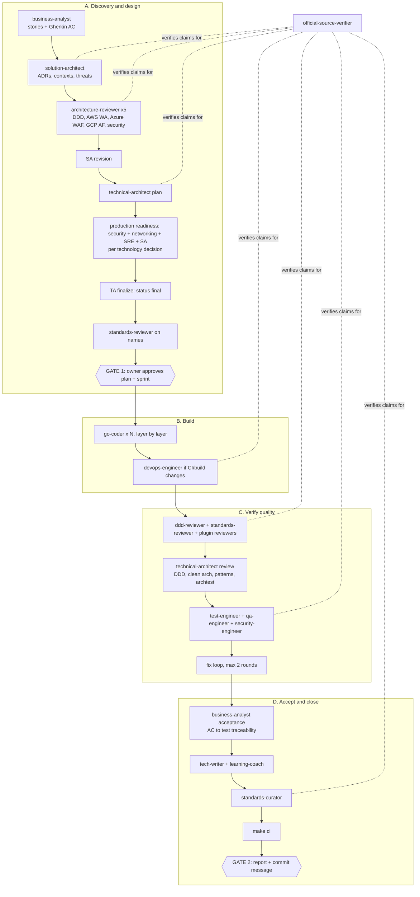

# SDLC workflow with Claude Code agents

The repository ships a project agent team in `.claude/`. Each agent preloads only the skills it needs, so the main session stays small.

## Team

| Stage | Agent | Model | Writes |
|---|---|---|---|
| Orchestration | `sdlc-orchestrator` | opus | nothing (coordinates) |
| Requirements and acceptance | `business-analyst` | opus | `docs/backlog/` (epics, features, stories with Gherkin AC, sprints); `docs/requirements/` (FR, glossary, traceability) |
| Solution design | `solution-architect` | opus | `docs/requirements`, `docs/architecture`, `docs/adr`, `docs/security` |
| Architecture review board | `architecture-reviewer` x 5 lenses | opus | nothing (read-only) |
| Plan and conformance review | `technical-architect` | opus | `docs/superpowers/plans`, `services/timesheet-core/test/architecture` |
| Coding | `go-coder` (parallel) | sonnet | its assigned Go packages |
| Code review | `ddd-reviewer`, `standards-reviewer` (parallel) | sonnet | nothing (read-only) |
| Unit and integration tests | `test-engineer` (parallel) | sonnet | `*_test.go` and `testdata/` under `services/timesheet-core/test/` (ADR-0009) |
| Contract, e2e, fuzz, race, coverage | `qa-engineer` | sonnet | test code, `testdata/` |
| Production readiness: security | `security-engineer` | opus | `docs/security/` |
| Production readiness: networking | `networking-engineer` | sonnet | `docs/architecture/network.md` |
| Production readiness: reliability | `sre-engineer` | opus | `docs/operations/` (SLOs, failure modes, runbooks, postmortems) |
| CI, build, release | `devops-engineer` | sonnet | `.github/`, the root `Makefile`, `services/timesheet-core/{Makefile,Dockerfile,.dockerignore}`, `CHANGELOG.md` |
| Feature documentation | `tech-writer` | sonnet | `docs/features/`, README, CHANGELOG |
| Teaching | `learning-coach` | opus | `docs/learn/` |
| GitHub Issues mirror | `backlog-manager` | sonnet | `docs/backlog/.sync/`, issue numbers in frontmatter |
| Standards upkeep | `standards-curator` | sonnet | `.claude/skills/coding-standards/`, `services/timesheet-core/.golangci.yml` |
| External claim verification | `official-source-verifier` | sonnet | nothing; called by every agent above that cites a source |

Reused plugin agents: `pr-review-toolkit:silent-failure-hunter`, `pr-review-toolkit:type-design-analyzer`, `docs-param-verifier`.

## Pipeline



## Keeping the coding standards current

`standards-reviewer` reports patterns no rule covers (`UNCOVERED`). At the end of every `/sdlc` run the orchestrator hands them to `standards-curator`, which fetches the official source, adds a rule with its URL (or a linter to `services/timesheet-core/.golangci.yml`), and records the source in `sources.md`. Run `/update-standards verify` monthly; the session-start hook reminds you when sources are more than 30 days old.

## Other `.claude/` pieces

| Path | Purpose |
|---|---|
| `rules/*.md` | Path-scoped rules, loaded only when matching files are touched (domain, adapters, migrations, tests, containers, docs) |
| `hooks/` + `settings.json` `hooks` | Format Go after edits; block credential patterns in writes; block AI attribution, `--no-verify`, `--author`, force push; session status |
| `hooks/verify-build.sh` + agent frontmatter `hooks: Stop` | Build gate when `go-coder`, `test-engineer` or `qa-engineer` finish: `go build` and `go vet` (also with `-tags=integration`) in `services/timesheet-core`. Declared in each of those agent files, not in `settings.json` |
| `agent-memory/<agent>/MEMORY.md` | Persistent memory for single-instance agents (orchestrator, SA, TA, curator) |
| `workflows/review-fanout.js` | `/review-fanout`: deterministic per-context review with two-skeptic verification of every finding |
| `settings.json` `attribution` | Empty commit and PR attribution |

## Usage

```text
/sdlc Phase 2                       # design: requirements, ADRs, plan; stops at the gate
/sdlc Phase 2 --from implement      # after you approve the plan
/sdlc Phase 2 --from review         # review and test existing uncommitted changes
/review-fanout                      # review only, with adversarial verification
/learn <question>                   # ask about any feature or concept; the answer is saved to docs/learn
/backlog-sync [scope]               # draft the GitHub Issues mirror, publish only after you approve
/update-standards verify            # re-check every cited source; also: add <topic>, audit
```

## Guarantees

- Parallel coders own disjoint packages; shared files are edited sequentially.
- No agent commits, pushes or opens PRs (`git commit` and `git push` are `ask` in `.claude/settings.json`).
- `printenv` and `env` are denied so no agent can dump tokens.
- `TODO(owner)` code is never filled by agents.
- No external claim is accepted without a VERIFIED verdict from `official-source-verifier`.
