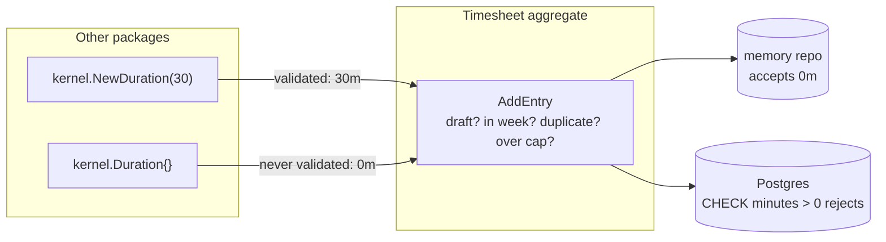

# Aggregates, invariants, and how Go zero values can bypass a constructor

Written 2026-10-09. Read first: [Clean Architecture dependency rule](clean-architecture-dependency-rule.md). Next: [Optimistic locking](optimistic-locking.md).

## Short answer

An **aggregate** is a group of domain objects that the code treats as one unit. One of them, the **aggregate root**, is the only door in, so it can protect the rules of the whole group. A rule that must always be true is an **invariant**, for example "a day's total never goes over the daily cap". A **value object** is a small value defined only by its content, like `kernel.Duration`, and its constructor rejects bad input. Go has a catch here: every type has a **zero value**, and `kernel.Duration{}` is legal Go in any package. That value is 0 minutes, which `NewDuration` would have refused, and the `Timesheet` aggregate accepts it (finding N4).

Terms used on this page:

- **Domain**: the business rules of the problem, here timesheets and worklogs, written without databases or HTTP.
- **Constructor**: in Go, an ordinary function such as `NewDuration` that checks its input and returns a value or an error.
- **Exported / unexported**: a Go name starting with a capital letter (`Minutes`) is visible to other packages; a lower-case name (`min`) is not.
- **Composite literal**: Go syntax that builds a struct, slice or map in place, such as `Duration{min: 30}` or `Duration{}`.

## In this codebase

**The aggregate root** is `Timesheet`: one user's worklogs for one ISO week ([`services/timesheet-core/internal/timesheet/domain/timesheet.go:19`](../../../services/timesheet-core/internal/timesheet/domain/timesheet.go#L19)). All its fields are lower case, so code outside `package domain` can change a timesheet only through its methods ([`services/timesheet-core/internal/timesheet/domain/timesheet.go:20-31`](../../../services/timesheet-core/internal/timesheet/domain/timesheet.go#L20-L31)).

**The invariants** live in those methods. `AddEntry` checks four of them before it appends anything:

```go
func (t *Timesheet) AddEntry(key kernel.IssueKey, issueID int64, day kernel.WorkDay, d kernel.Duration, description string) error {
	if t.status != StatusDraft {
		return ErrNotDraft
	}
	if !t.week.Contains(day) {
		return fmt.Errorf("%w: %s not in %s", ErrDayOutsideWeek, day, t.week)
	}
	for _, e := range t.entries {
		if e.IssueKey == key && e.Day == day {
			return fmt.Errorf("%w: %s on %s", ErrDuplicateEntry, key, day)
		}
	}
	if total := t.DayTotal(day) + d.Minutes(); total > t.dailyCap.Minutes() {
		return fmt.Errorf("%w: %s would be %dm, cap %dm", ErrDayOverCap, day, total, t.dailyCap.Minutes())
	}
	t.entries = append(t.entries, Entry{
		ID:       fmt.Sprintf("%s/%s/%s", t.id, day, key),
		IssueKey: key, IssueID: issueID, Day: day, Duration: d, Description: description,
	})
	return nil
}
```

1. Entries can only be added while the timesheet is a draft.
2. The day must fall inside the timesheet's week.
3. There is at most one entry per issue per day.
4. A day's total never goes over `dailyCap`.

Other methods guard the status lifecycle. For example, `Propose` refuses an empty timesheet ([`services/timesheet-core/internal/timesheet/domain/timesheet.go:155`](../../../services/timesheet-core/internal/timesheet/domain/timesheet.go#L155)). `TestAddEntryInvariants` proves the rules ([`services/timesheet-core/test/unit/timesheet/domain/timesheet_test.go:85`](../../../services/timesheet-core/test/unit/timesheet/domain/timesheet_test.go#L85)).

**The value object** `Duration` keeps its minutes in an unexported field, and `NewDuration` refuses anything that is not a positive multiple of 15:

```go
type Duration struct{ min int }

// NewDuration returns a Duration of the given number of minutes. It returns an
// error unless minutes is a positive multiple of [Granularity].
func NewDuration(minutes int) (Duration, error) {
	if minutes <= 0 || minutes%Granularity != 0 {
		return Duration{}, fmt.Errorf("duration %dm must be a positive multiple of %dm", minutes, Granularity)
	}
	return Duration{min: minutes}, nil
}
```

Because `min` is unexported, another package cannot write `kernel.Duration{min: 7}`. The compiler refuses it with "cannot refer to unexported field min in struct literal". This was checked with Go 1.26.9 on a copy of the same type. `WorkDay` uses the same trick for "Monday to Friday only" ([`services/timesheet-core/internal/shared/kernel/workday.go:13`](../../../services/timesheet-core/internal/shared/kernel/workday.go#L13)).

**Zero values in Go.** The Go specification says that when a variable or value is created "and no explicit initialization is provided, the variable or value is given a default value. Each element of such a variable or value is set to the zero value for its type" (section "The zero value"). For composite literals it says: "A literal may omit the element list; such a literal evaluates to the zero value for its type." So `kernel.Duration{}` and `var d kernel.Duration` are both legal in any package, and both hold `min == 0`.

## Why it matters

The aggregate trusts its inputs. `AddEntry` takes a `kernel.Duration` and only checks the daily cap. It never checks that the duration is positive, because it assumes a `Duration` can only come from `NewDuration`. The zero value breaks that trust. A 0-minute worklog is meaningless, yet nothing in the domain stops it.

## Common mistake: trusting that the constructor is the only way in (findings N4 and L9)

N4: "The `Timesheet` aggregate accepts a zero `Duration` or an empty `IssueKey`, and `New` accepts an empty owner" ([`docs/architecture/project-structure.md:183`](../../../docs/architecture/project-structure.md#L183)). L9 is the kernel-side half: some value objects can be built without their constructors, including the zero values `Duration{}` and `WorkDay{}` ([`docs/architecture/project-structure.md:177`](../../../docs/architecture/project-structure.md#L177)). `docs/architecture/code-map.md` describes the same limit ([`docs/architecture/code-map.md:9`](../../../docs/architecture/code-map.md#L9)).

Checked on 2026-10-09 with a temporary test, run through `go test -overlay` so no repository file changed:

```go
ts := New("id", "u", week, kernel.MustDuration(480), "rule", time.Now())
err := ts.AddEntry("GCM-1", 1, mon, kernel.Duration{}, "x")
// err == nil; the entry is stored with Duration.Minutes() == 0
```

What happens next depends on the repository adapter:

- With the in-memory repository, used for `--dry-run` and tests ([`services/timesheet-core/cmd/timesheet/wire.go:47`](../../../services/timesheet-core/cmd/timesheet/wire.go#L47)), the 0-minute entry is saved and shown.
- With Postgres, the save fails on the table's check constraint ([`services/timesheet-core/migrations/00001_init.sql:23`](../../../services/timesheet-core/migrations/00001_init.sql#L23)). The database, the outermost layer, is enforcing a rule the aggregate should own.

The rest of N4 works the same way. `AddEntry` never checks that the issue key is non-empty, and `New` checks none of its arguments, so an empty owner id or a zero `dailyCap` gets through ([`services/timesheet-core/internal/timesheet/domain/timesheet.go:38`](../../../services/timesheet-core/internal/timesheet/domain/timesheet.go#L38)). L9's other two cases are similar: `kernel.IssueKey("anything")` is a plain type conversion that skips `NewIssueKey` ([`services/timesheet-core/internal/shared/kernel/issuekey.go:9`](../../../services/timesheet-core/internal/shared/kernel/issuekey.go#L9)), and `WeekID` has exported fields, so `kernel.WeekID{Year: 2026, Week: 99}` is legal ([`services/timesheet-core/internal/shared/kernel/week.go:9-11`](../../../services/timesheet-core/internal/shared/kernel/week.go#L9-L11)).

Options. The [SP-01 hardening plan](../../superpowers/plans/2026-10-09-sp01-hardening.md) (`status: draft`) proposes option 1, with new `ErrInvalidTimesheet` and `ErrInvalidEntry` errors, as part of work package WP-1:

1. Make the root check its own invariant, for example by rejecting `d.Minutes() <= 0` in `AddEntry`. The aggregate then stays correct no matter how the value was made.
2. Give `Duration` an `IsZero()` method, like `WorkDay.IsZero` ([`services/timesheet-core/internal/shared/kernel/workday.go:46`](../../../services/timesheet-core/internal/shared/kernel/workday.go#L46)), and reject zero values wherever outside data enters.
3. Declare that the zero value means "no duration", and document it.

## Picture



## Try it

1. Create `test/unit/timesheet/domain/zz_zero_test.go` (a scratch file) with the test below, run it, then **delete the file**. Tests live in `test/`, not beside the code ([ADR-0009](../../adr/0009-tests-in-separate-tree.md)), so the test imports `domain` like any other caller.

```go
package domain_test

import (
	"testing"
	"time"

	"timesheet-bot/internal/shared/kernel"
	"timesheet-bot/internal/timesheet/domain"
)

func TestZeroDurationBypass(t *testing.T) {
	week, _ := kernel.ParseWeekID("2026-W41")
	mon, _ := kernel.ParseWorkDay("2026-10-05")
	ts := domain.New("id", "u", week, kernel.MustDuration(480), "rule", time.Now())
	if err := ts.AddEntry("GCM-1", 1, mon, kernel.Duration{}, "x"); err != nil {
		t.Fatalf("rejected: %v", err)
	}
	t.Logf("accepted entry with %d minutes", ts.Entries()[0].Duration.Minutes())
}
```

```sh
cd services/timesheet-core
go test -run TestZeroDurationBypass -v ./test/unit/timesheet/domain/
rm test/unit/timesheet/domain/zz_zero_test.go
```

2. In the same scratch file, try `kernel.Duration{min: 30}` and read the compiler error.

## Check yourself

1. Why are all of `Timesheet`'s fields lower case?
2. Outside `package kernel`, is `var d kernel.Duration` valid Go, and what does `d.Minutes()` return?
3. Today, which layer stops a 0-minute entry when Postgres is used, and which layer stops it in `--dry-run`?

<details>
<summary>Answers</summary>

1. So other packages can only change a timesheet through its methods, which check the invariants. That is what makes `Timesheet` the aggregate root, the single door in.
2. Yes. Every variable gets its type's zero value, so `d.min` is 0 and `d.Minutes()` returns 0.
3. With Postgres, the `CHECK (minutes > 0 ...)` constraint in `00001_init.sql` rejects the save. In `--dry-run`, the memory repository has no such check, so nothing stops it.

</details>

## Go deeper

- Martin Fowler, "DDD Aggregate", 23 April 2013: <https://martinfowler.com/bliki/DDD_Aggregate.html>. VERIFIED 2026-10-09. Quotes checked against the live page: "A DDD aggregate is a cluster of domain objects that can be treated as a single unit", "Any references from outside the aggregate should only go to the aggregate root", "The root can thus ensure the integrity of the aggregate as a whole", and "Transactions should not cross aggregate boundaries".
- The Go Programming Language Specification, "The zero value" (<https://go.dev/ref/spec#The_zero_value>) and "Composite literals" (<https://go.dev/ref/spec#Composite_literals>). VERIFIED 2026-10-09; the two quotes above were checked against the live page. The specification text found does not itself state the rule about unexported fields in another package's struct literal, so this page relies on the compiler error, which was reproduced, for that point.
