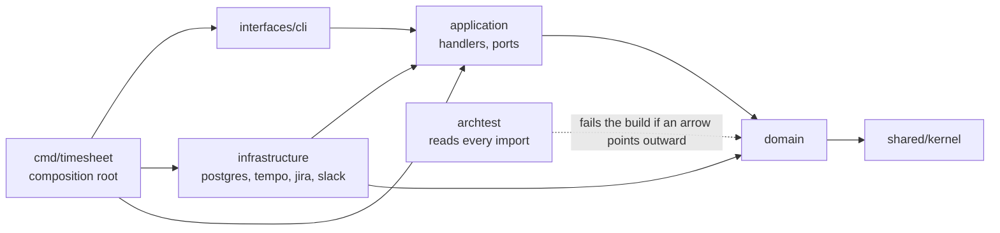

# Clean Architecture dependency rule and architecture fitness functions

Written 2026-10-09. Read first: nothing, this is the starting page. Next: [Ports and adapters](ports-and-adapters.md).

## Short answer

Clean Architecture arranges code in rings. The inner rings hold the business rules. The outer rings hold the tools: the database, HTTP clients, the command line. The **dependency rule** says inner code never mentions outer code. In Robert C. Martin's words, "source code dependencies can only point inwards". An **architecture fitness function** is an automated check that an architecture property still holds. In this repository that check is `test/architecture/archtest_test.go` ("archtest" for short), a Go test that reads every `import` line of the production code and fails the build when an inner package imports an outer one. It lived in `internal/archtest` until [ADR-0009](../../adr/0009-tests-in-separate-tree.md) moved every test into `services/timesheet-core/test/`.

Terms used on this page:

- **Dependency**: package A depends on package B when A's source code imports B.
- **Layer**: a group of packages with the same job. Here they are domain, application, infrastructure, interfaces and the composition root.
- **Composition root**: the one place that builds the concrete objects and plugs them together. Here that is `cmd/timesheet/wire.go`.
- **Regular expression (regexp)**: a text pattern. `archtest` uses regexps to describe which packages a rule applies to and which imports it forbids.

## In this codebase

The rings, from inner to outer, map onto folder names. `docs/architecture/project-structure.md` has the full table ([`docs/architecture/project-structure.md:138-145`](../../../docs/architecture/project-structure.md#L138-L145)).

| Ring | Folders | Example |
|---|---|---|
| Domain and shared kernel | `internal/<context>/domain`, `internal/shared/kernel` | the `Timesheet` aggregate |
| Application | `internal/<context>/application` | `SubmitHandler` |
| Infrastructure (adapters) | `internal/<context>/infrastructure/...` | the Tempo HTTP client |
| Interfaces | `internal/interfaces/cli` | cobra commands |
| Composition root | `cmd/timesheet` | `buildApp` in `wire.go` |

The package comment says why `archtest` exists ([`services/timesheet-core/test/architecture/archtest_test.go:1-4`](../../../services/timesheet-core/test/architecture/archtest_test.go#L1-L4)): it turns the rules into tests, "so a violation fails the build instead of waiting for review". This is the repository's own description of a fitness function.

The rules are plain data, a slice of `rule` values ([`services/timesheet-core/test/architecture/archtest_test.go:38`](../../../services/timesheet-core/test/architecture/archtest_test.go#L38)). Here is the first one, for the innermost ring:

```go
name:  "domain and kernel import only the stdlib, the kernel and their own context",
from:  regexp.MustCompile(`^internal/(shared/kernel|[a-z]+/domain)$`),
allow: regexp.MustCompile(`^` + module + `/internal/shared/kernel$`),
deny:  []*regexp.Regexp{regexp.MustCompile(`^(net(/|$)|database/|os/exec$)`)},
```

`from` picks the packages the rule applies to. `allow` is an **allow list**: any import that is not from the standard library, not the kernel and not the package's own context fails. `deny` additionally blocks networking, database and process packages from the standard library.

How the check runs:

1. `imports` walks only the production trees, `internal/` and `cmd/` ([`services/timesheet-core/test/architecture/archtest_test.go:26`](../../../services/timesheet-core/test/architecture/archtest_test.go#L26), [`services/timesheet-core/test/architecture/archtest_test.go:95-99`](../../../services/timesheet-core/test/architecture/archtest_test.go#L95-L99)), and parses only the import block of each `.go` file ([`services/timesheet-core/test/architecture/archtest_test.go:115`](../../../services/timesheet-core/test/architecture/archtest_test.go#L115)). It skips `_test.go` files ([`services/timesheet-core/test/architecture/archtest_test.go:112`](../../../services/timesheet-core/test/architecture/archtest_test.go#L112)) and never reads `test/`, so tests may import fakes and helpers.
2. `TestDependencyRules` checks every package against every rule ([`services/timesheet-core/test/architecture/archtest_test.go:135`](../../../services/timesheet-core/test/architecture/archtest_test.go#L135)).
3. A guard fails a rule that matched no package at all ([`services/timesheet-core/test/architecture/archtest_test.go:158-162`](../../../services/timesheet-core/test/architecture/archtest_test.go#L158-L162)). Without it, a typo in a `from` pattern would switch the rule off silently (see N3 below).
4. `TestDomainHasNoWallClock` fails when domain or application code calls `time.Now()` ([`services/timesheet-core/test/architecture/archtest_test.go:172`](../../../services/timesheet-core/test/architecture/archtest_test.go#L172)). That code must take a `kernel.Clock` instead ([`services/timesheet-core/internal/shared/kernel/clock.go:7`](../../../services/timesheet-core/internal/shared/kernel/clock.go#L7)), so tests can fix the time.

One more rule points the other way: production code never imports the test tree ([`services/timesheet-core/test/architecture/archtest_test.go:67-71`](../../../services/timesheet-core/test/architecture/archtest_test.go#L67-L71)), so test helpers can never end up in the binary.

You run it with `make arch` ([`services/timesheet-core/Makefile:40-41`](../../../services/timesheet-core/Makefile#L40-L41)), which prints `ok timesheet-bot/test/architecture`. `make test` runs it too, because it runs `go test ./...` ([`services/timesheet-core/Makefile:14`](../../../services/timesheet-core/Makefile#L14)).

## Why it matters

Picture a quick fix: someone imports `pgx`, the Postgres driver, into `SubmitHandler` to "just check one row". From then on the submit use case cannot be tested without a database, and replacing the database means editing business code. A reviewer might catch it, or might not. A fitness function always catches it, on the developer's machine, before review.

## Common mistake: a rule that looks complete but has holes (findings M4, N1, N2, N3)

The 2026-10-09 review sums it up as "archtest enforces the layer rules only partly" ([`docs/architecture/project-structure.md:165`](../../../docs/architecture/project-structure.md#L165)). The regular expressions behind each gap below were run against sample inputs on 2026-10-09 to confirm it. The fixes are work package WP-3 of the [SP-01 hardening plan](../../superpowers/plans/2026-10-09-sp01-hardening.md), which is still `status: draft`.

**M4 and N2: deny lists instead of allow lists.** M4 ([`docs/architecture/project-structure.md:172`](../../../docs/architecture/project-structure.md#L172)) is about the application rule:

```go
name: "application layers do not depend on infrastructure, interfaces, platform or cmd",
from: regexp.MustCompile(`^internal/[a-z]+/application$`),
deny: []*regexp.Regexp{
	regexp.MustCompile(`/infrastructure(/|$)`),
	regexp.MustCompile(`^` + module + `/internal/(interfaces|platform)(/|$)`),
	regexp.MustCompile(`^` + module + `/cmd(/|$)`),
```

It blocks anything with `/infrastructure` in the path, `internal/interfaces`, `internal/platform` and `cmd`, and nothing else. So `net/http`, `timesheet-bot/internal/config`, `timesheet-bot/internal/shared/httpx` and any third-party package such as `github.com/jackc/pgx/v5` all pass. One case already exists: `propose.go` imports `github.com/google/uuid` ([`services/timesheet-core/internal/timesheet/application/propose.go:8`](../../../services/timesheet-core/internal/timesheet/application/propose.go#L8)) and the test is green. That import is itself recorded as N5 ([`docs/architecture/project-structure.md:184`](../../../docs/architecture/project-structure.md#L184)). A UUID library is harmless, but the test would be just as green for `pgx`. The domain rule above avoids this because it uses `allow`. N2 ([`docs/architecture/project-structure.md:181`](../../../docs/architecture/project-structure.md#L181)) records the same weakness in the other rules: the interfaces rule denies only `/infrastructure` ([`services/timesheet-core/test/architecture/archtest_test.go:63-65`](../../../services/timesheet-core/test/architecture/archtest_test.go#L63-L65)), and the infrastructure rule denies only `interfaces` and `cmd`.

**N3: a rule can check nothing and still pass, and the wall-clock check matches only one spelling** ([`docs/architecture/project-structure.md:182`](../../../docs/architecture/project-structure.md#L182)). When the review ran, one `checked` counter was shared by all rules, so a rule whose `from` pattern matched nothing still passed as long as another rule matched something. The test rewrite later on 2026-10-09 moved the counter inside each rule (the guard in step 3 above), which closes that half in the working tree. The other half is still open. The wall-clock pattern is `\btime\.Now\(\)` ([`services/timesheet-core/test/architecture/archtest_test.go:168`](../../../services/timesheet-core/test/architecture/archtest_test.go#L168)). `time.Since(start)` and `time.Until(t)` also read the wall clock, and so does `now := time.Now` (the function itself, without the brackets). None of these match.

**N1: the path patterns match exactly one directory level** ([`docs/architecture/project-structure.md:180`](../../../docs/architecture/project-structure.md#L180)). The domain rule needs a package path to match `^internal/(shared/kernel|[a-z]+/domain)$`, and the application rule `^internal/[a-z]+/application$`. The `$` means "end of text". A sub-package such as `internal/timesheet/domain/rules` matches neither rule, so it has no restrictions at all. The same is true for a context whose name contains a digit or an underscore. The per-rule guard does not help, because each rule still matches its other packages.

The lesson: a fitness function is only as strong as its patterns. Prefer allow lists, and test the test with an input you know is bad.

## Picture



Every arrow points inward. `archtest` checks the arrows by reading import lines, not by reading this picture.

## Try it

1. In `services/timesheet-core`, run `make arch`. It passes.
2. See M4 for yourself. Create a scratch file `internal/timesheet/application/zz_gap.go` containing `package application` and `import _ "github.com/jackc/pgx/v5"`. Run `make arch`. According to the rule above it still passes. Then change the import to `_ "timesheet-bot/internal/timesheet/infrastructure/memory"` and run it again. Now it should fail. **Delete the scratch file afterwards.**
3. Read `rules` again and write down, in one sentence, what an allow-list version of the application rule would allow.

## Check yourself

1. Why does each rule in `TestDependencyRules` fail when it matched no package?
2. `internal/timesheet/application` starts importing `timesheet-bot/internal/config`. Does `make arch` fail?
3. May `internal/timesheet/domain` import `internal/timesheet/application`?

<details>
<summary>Answers</summary>

1. A rule that matches no package checks nothing, so it would pass however wrong the code is. That happens after a typo in the pattern or a renamed directory. The guard turns "checked nothing" into a failure. Before the 2026-10-09 test rewrite the count was shared by all rules, so one broken rule could hide behind the others (N3).
2. No. The application rule only denies infrastructure, interfaces, platform and cmd, so `internal/config` passes (finding M4).
3. No. The domain rule allows only the standard library, the kernel and the package's own `domain` packages. `application` is an outer ring, so importing it is reported as "not allowed".

</details>

## Go deeper

- Robert C. Martin, "The Clean Architecture", 13 August 2012: <https://blog.cleancoder.com/uncle-bob/2012/08/13/the-clean-architecture.html>. VERIFIED 2026-10-09; the quotes "source code dependencies can only point inwards" and "the name of something declared in an outer circle must not be mentioned by the code in the an inner circle" (the typo "the an" is in the original) were checked against the live page.
- Neal Ford, Rebecca Parsons, Patrick Kua and Pramod Sadalage, *Building Evolutionary Architectures*, 2nd edition, subtitle "Automated Software Governance", chapter on fitness functions. The title, edition and authors were VERIFIED on the Thoughtworks book page (<https://www.thoughtworks.com/insights/books/building-evolutionaryarchitectures-second-edition>), which says the book "details how fitness functions can be used to drive, manage, and automate change across all of the architectural concerns". The chapter text itself is UNVERIFIED: the publisher's page returned HTTP 403. This page therefore does not quote or paraphrase the book's definition; the plain-words definition above is this page's own.
- In this repository: [ADR-0001](../../adr/0001-ddd-package-by-bounded-context.md) and [project structure](../../architecture/project-structure.md).
