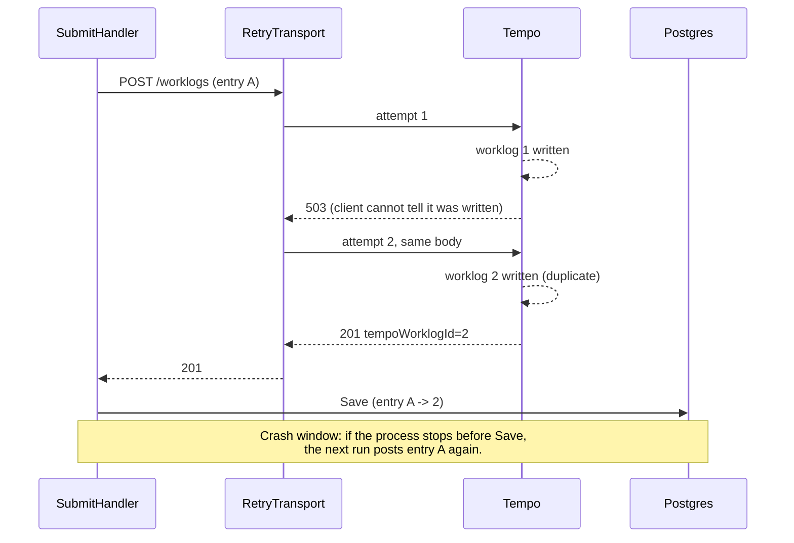

# Idempotency and safe retries

Written 2026-10-09. Read first: [Ports and adapters](ports-and-adapters.md). Related: [Transactional outbox](transactional-outbox.md), whose relay can also deliver twice.

## Short answer

An operation is **idempotent** when doing it twice has the same intended effect as doing it once. HTTP's standard, RFC 9110 section 9.2.2, says PUT, DELETE and the safe methods (GET, HEAD, OPTIONS, TRACE) are idempotent. POST is not. Retrying a POST can therefore create a second copy of whatever the first POST created. This repository's HTTP transport retries every request on 429 and 5xx, including the POST that creates a Tempo worklog. So one entry can become two worklogs (finding H2).

Terms used on this page:

- **Retry**: sending the same request again after a failure, hoping the failure was temporary.
- **Transport** (`http.RoundTripper` in Go): the layer under `http.Client` that sends one request and returns one response. A transport that retries does so without its caller knowing.
- **5xx / 429**: HTTP status codes. 5xx means "server error". 429 means "too many requests, slow down".
- **Side effect**: a lasting change the request causes, such as a new worklog row in Tempo.
- **Safe method**: a method meant only to read, never to change anything (RFC 9110 section 9.2.1).

## In this codebase

**The retrying transport.** `RetryTransport` decides whether to retry from the status code alone:

```go
func retryable(code int) bool {
	return code == http.StatusTooManyRequests || code >= 500
}
```

The loop returns only on a transport error, on the last attempt, or on a non-retryable code ([`services/timesheet-core/internal/shared/httpx/retry.go:53`](../../../services/timesheet-core/internal/shared/httpx/retry.go#L53)). It never looks at `req.Method`. When it retries a request that has a body, it gets a fresh copy of the body from `req.GetBody` ([`services/timesheet-core/internal/shared/httpx/retry.go:40-49`](../../../services/timesheet-core/internal/shared/httpx/retry.go#L40-L49)). The default is 5 attempts in total ([`services/timesheet-core/internal/shared/httpx/retry.go:34`](../../../services/timesheet-core/internal/shared/httpx/retry.go#L34)).

**Every adapter shares it.** `NewClient` installs the transport ([`services/timesheet-core/internal/shared/httpx/retry.go:90-91`](../../../services/timesheet-core/internal/shared/httpx/retry.go#L90-L91)). The composition root builds one client ([`services/timesheet-core/cmd/timesheet/wire.go:44`](../../../services/timesheet-core/cmd/timesheet/wire.go#L44)) and passes it to the Tempo adapter ([`services/timesheet-core/cmd/timesheet/wire.go:73`](../../../services/timesheet-core/cmd/timesheet/wire.go#L73)).

**Tempo's create is a POST** ([`services/timesheet-core/internal/timesheet/infrastructure/tempo/client.go:62`](../../../services/timesheet-core/internal/timesheet/infrastructure/tempo/client.go#L62)). The body is a `bytes.Reader`, and Go's `http.NewRequestWithContext` documentation says that for such a body "GetBody is populated". So the transport can and does replay it. `TestRetryResendsBody` proves this: a POST answered with 429 is sent a second time with the same body ([`services/timesheet-core/test/unit/httpx/retry_test.go:143`](../../../services/timesheet-core/test/unit/httpx/retry_test.go#L143)).

**What the application already does right.** `SubmitHandler` saves the timesheet after every Tempo call, storing the returned worklog id ([`services/timesheet-core/internal/timesheet/application/submit.go:73`](../../../services/timesheet-core/internal/timesheet/application/submit.go#L73)). On the next run, entries with an id are skipped ([`services/timesheet-core/internal/timesheet/application/submit.go:51`](../../../services/timesheet-core/internal/timesheet/application/submit.go#L51)). `TestSubmitPartialFailureThenRetry` checks that a second run sends only the entry that failed, giving 3 worklogs and not 4 ([`services/timesheet-core/test/unit/timesheet/application/handlers_test.go:432`](../../../services/timesheet-core/test/unit/timesheet/application/handlers_test.go#L432)).

## Why it matters

A duplicate worklog in Tempo is someone's hours counted twice. It is wrong in a report and has to be found and deleted by hand. The person who notices is the timesheet's owner, not the program.

## Common mistake: retrying a non-idempotent request (finding H2)

Recorded as H2: "Tempo creates are not idempotent: the transport retries POST on 5xx, and a crash between Tempo's success and the save re-posts on the next run" ([`docs/architecture/project-structure.md:170`](../../../docs/architecture/project-structure.md#L170)). There are two separate ways to get a duplicate.

1. **The transport retry.** Tempo receives the POST and returns a 5xx. A 5xx says something failed, but it does not tell the client whether the worklog was already written before the failure. `RetryTransport` sends the same POST again, up to 5 times in total. If the first attempt had already been applied, the second creates a duplicate. RFC 9110 warns against exactly this: "A client SHOULD NOT automatically retry a request with a non-idempotent method unless it has some means to know that the request semantics are actually idempotent, regardless of the method, or some means to detect that the original request was never applied."
2. **The crash window.** `Gateway.Create` succeeds ([`services/timesheet-core/internal/timesheet/application/submit.go:54`](../../../services/timesheet-core/internal/timesheet/application/submit.go#L54)), but the process stops (laptop sleep, Ctrl-C, crash) before `Repo.Save` stores the id. The database still shows the entry as pending, so the next `submit` posts it again.

Two documents promise more than the code delivers. The `SubmitHandler` comment says a crash or retry "never sends the same entry twice" ([`services/timesheet-core/internal/timesheet/application/submit.go:23`](../../../services/timesheet-core/internal/timesheet/application/submit.go#L23)). [ADR-0002](../../adr/0002-postgres-with-transactional-outbox.md) lists "no lost or duplicated work" as a consequence. `docs/architecture/code-map.md` states the real limit ([`docs/architecture/code-map.md:19`](../../../docs/architecture/code-map.md#L19)).

Ways to close it. The [SP-01 hardening plan](../../superpowers/plans/2026-10-09-sp01-hardening.md) (`status: draft`) proposes the first and third: "The HTTP transport retries only safe cases" and "The application reconciles against Tempo before any re-post".

- Do not retry non-idempotent methods in the transport: retry POST only where the endpoint is known to be idempotent. This is what RFC 9110 recommends.
- Send a unique, caller-chosen request id with each create, so the server can recognise a repeat. This is the approach the AWS article below describes. Whether Tempo's API accepts such an id is UNVERIFIED; it was not checked for this page.
- Before re-posting a pending entry, look in Tempo for a worklog that matches it (issue, day, start time, author). This is RFC 9110's "some means to detect that the original request was never applied". Whether Tempo offers a suitable search was also not checked.

## Picture



## Try it

1. In `services/timesheet-core`, run `go test -run TestRetryResendsBody -v ./internal/shared/httpx/` and read the test: it is a POST, and the server sees the body twice.
2. Read `retryable` and the line that calls it. Write down the one condition you would add so a POST is never retried, and which existing test you would copy to prove it.

## Check yourself

1. Is DELETE idempotent according to RFC 9110?
2. Tempo answers 503 to every attempt of `POST /worklogs`. How many POSTs does the transport send for one entry?
3. `SubmitHandler` saves after every entry. Why does that still not rule out duplicates?

<details>
<summary>Answers</summary>

1. Yes. Section 9.2.2: "PUT, DELETE, and safe request methods are idempotent."
2. Five, unless the 30-second client timeout set in `wire.go` runs out first. `MaxAttempts` defaults to 5 total attempts, 503 is retryable, and the fifth response is returned to the caller.
3. Saving after each entry protects against resending entries whose id is already stored. It does not cover a duplicate created inside one call by the transport retry, or a crash between Tempo's success and the save.

</details>

## Go deeper

- RFC 9110, "HTTP Semantics", section 9.2.2 "Idempotent Methods": <https://www.rfc-editor.org/rfc/rfc9110#section-9.2.2>. VERIFIED 2026-10-09; the quotes above were checked against the text fetched from rfc-editor.org. Section 9.2.1 lists GET, HEAD, OPTIONS and TRACE as safe.
- "Making retries safe with idempotent APIs", Amazon Builders' Library. The old address <https://aws.amazon.com/builders-library/making-retries-safe-with-idempotent-apis/> now redirects (HTTP 301) to <https://builder.aws.com/content/3Ev0BENTyBr0XxzRk5FDZzgNYos/making-retries-safe-with-idempotent-apis>. VERIFIED 2026-10-09. Quotes: "An idempotent operation is one where a request can be retransmitted or retried with no additional side effects", and "At Amazon, our preferred approach is to incorporate a unique caller-provided client request identifier into our API contract."
- Go `net/http` documentation for `NewRequestWithContext` (read with `go doc net/http.NewRequestWithContext`, Go 1.26.9): for a `*bytes.Reader` body, "GetBody is populated".
