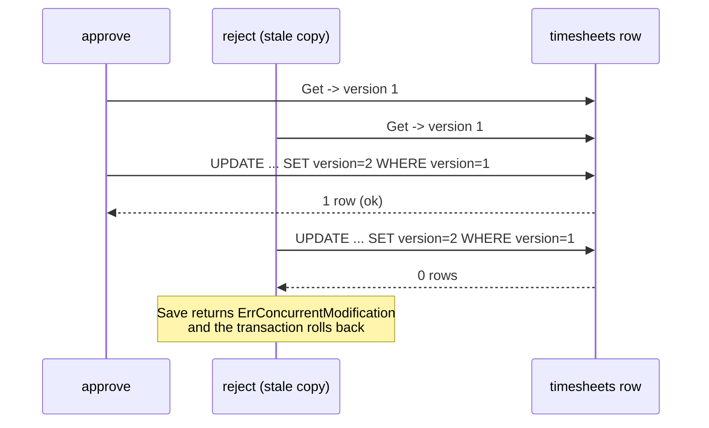

# Optimistic locking

Written 2026-10-09. Read first: [Aggregates and invariants](aggregates-invariants-and-zero-values.md). Next: [Transactional outbox](transactional-outbox.md).

## Short answer

Two commands can load the same timesheet at the same moment, for example `approve` and `reject` started a second apart. If both save, the second one silently overwrites the first. **Optimistic locking** stops that without holding a database lock while you work. Each row carries a **version** number. A save says "update this row only if its version is still the one I read". If no row changed, someone else saved first, and the save fails with `ErrConcurrentModification` instead of overwriting their work.

Terms used on this page:

- **Concurrent**: happening at overlapping times.
- **Lost update**: one writer's change overwritten by another writer who never saw it.
- **Pessimistic locking**, for contrast: lock the row when you read it (for example `SELECT ... FOR UPDATE`) so nobody else can change it until you finish. "Optimistic" means you assume conflicts are rare and only check at save time.
- **Isolation level**: the rules a database uses to decide what one transaction sees of another's changes.

## In this codebase

**The version lives on the aggregate** ([`services/timesheet-core/internal/timesheet/domain/timesheet.go:28`](../../../services/timesheet-core/internal/timesheet/domain/timesheet.go#L28)). Only repositories set it, after a save ([`services/timesheet-core/internal/timesheet/domain/timesheet.go:105-106`](../../../services/timesheet-core/internal/timesheet/domain/timesheet.go#L105-L106)). The table has a matching column ([`services/timesheet-core/migrations/00001_init.sql:9`](../../../services/timesheet-core/migrations/00001_init.sql#L9)).

**The conflict error** is a domain error, so handlers can test for it with `errors.Is` without knowing about Postgres ([`services/timesheet-core/internal/timesheet/domain/errors.go:33`](../../../services/timesheet-core/internal/timesheet/domain/errors.go#L33)).

**The check in Postgres.** Version 0 means "never saved", so the row is inserted. Otherwise the `UPDATE` includes the version that was read:

```go
tag, err := tx.Exec(ctx, `
	UPDATE timesheets SET status = $1, policy = $2, version = $3, proposal_revision = $4, updated_at = now()
	WHERE id = $5 AND version = $6`,
	string(s.Status), s.Policy, next, s.Revision, s.ID, s.Version)
if err != nil {
	return fmt.Errorf("update timesheet: %w", err)
}
if tag.RowsAffected() == 0 {
	return domain.ErrConcurrentModification
}
```

If another save already raised the version, `WHERE id = $5 AND version = $6` matches nothing, `RowsAffected()` is 0, and `Save` returns `ErrConcurrentModification`. Because the function returned an error, `pgx.BeginFunc` rolls the whole transaction back.

**The same check in memory**, for tests and `--dry-run`:

```go
if cur, ok := r.byKey[k]; ok && (cur.ID != t.ID() || cur.Version != t.Version()) {
	return domain.ErrConcurrentModification
} else if !ok && t.Version() != 0 {
	return domain.ErrConcurrentModification
}
```

**The proof.** The integration test loads the same timesheet twice, saves an approval from the first copy, then tries to save a rejection from the stale second copy, and expects `ErrConcurrentModification` ([`services/timesheet-core/test/integration/postgres/repository_test.go:93-108`](../../../services/timesheet-core/test/integration/postgres/repository_test.go#L93-L108)).

**Why this works under PostgreSQL's default isolation level.** The PostgreSQL 18 manual says "Read Committed is the default isolation level in PostgreSQL" and that `UPDATE` commands "will only find target rows that were committed as of the command start time". If a second updater finds a row that another transaction is changing, "the would-be updater will wait for the first updating transaction to commit or roll back", and then "The search condition of the command (the WHERE clause) is re-evaluated to see if the updated version of the row still matches the search condition." After the first save commits, the row's version is `n + 1`, so the second `WHERE ... version = n` no longer matches, and 0 rows are updated.

## Why it matters

Without the version check: you run `approve`, and a moment later a Slack button `[planned: P2]` runs `reject` on a copy loaded before your approval. The reject would overwrite the approve, and `submit` would then refuse a timesheet you approved, with no record of why. With the check, the late save fails loudly, and the user can reload and decide.

Today nothing retries on this error. It reaches the CLI as an error message, which is the honest result for a personal tool.

## Common mistakes in this repository (findings M5, L10 and N7)

**M5: the version is bumped before the commit succeeds.** `t.SetVersion(next)` runs inside the transaction function ([`services/timesheet-core/internal/timesheet/infrastructure/postgres/repository.go:136`](../../../services/timesheet-core/internal/timesheet/infrastructure/postgres/repository.go#L136)), before `COMMIT`. If the commit fails, the database keeps version `n` but the object says `n + 1`. Every later save of that object then fails with `ErrConcurrentModification`, even though nobody else wrote anything. The in-memory version must only change after the database has confirmed the change. See [Transactional outbox](transactional-outbox.md), which loses events at the same point.

**L10: the two repositories disagree about the first save.** The review: "memory checks the stored id and version per user and week, Postgres checks the version per id and relies on the unique constraint for inserts" ([`docs/architecture/project-structure.md:178`](../../../docs/architecture/project-structure.md#L178)). Suppose two different timesheets for the same user and week are both saved as new (version 0):

- The memory repository returns `ErrConcurrentModification`, because `cur.ID != t.ID()` (excerpt above).
- Postgres runs the `INSERT` and hits the table's unique rule ([`services/timesheet-core/migrations/00001_init.sql:14`](../../../services/timesheet-core/migrations/00001_init.sql#L14)). It returns a wrapped unique-violation error, "insert timesheet: ...", which is not `ErrConcurrentModification`.

Code that checks `errors.Is(err, domain.ErrConcurrentModification)` passes its tests against the memory repository and then behaves differently in production. Two adapters of one port must report the same situation with the same error. The [SP-01 hardening plan](../../superpowers/plans/2026-10-09-sp01-hardening.md) (`status: draft`) plans a shared contract test for both repositories and a mapping of the unique-violation error.

**N7: nothing stops other code calling `SetVersion`.** `SetVersion`, `Snapshot` and `Rehydrate` are exported because repositories in other packages need them, but "have no fitness test restricting them to repositories" ([`docs/architecture/project-structure.md:186`](../../../docs/architecture/project-structure.md#L186)). A handler that called `t.SetVersion(t.Version() + 1)` before saving would make every save fail, and one that copied a newer version in would make a stale save succeed. Optimistic locking only works if the version changes in exactly one place.

## Picture



## Try it

1. Read the memory repository's `Save` and explain to yourself each of the two conditions that return `ErrConcurrentModification`.
2. If you have Docker: `docker compose up -d db`, then `make test-int` in `services/timesheet-core`. Find the stale-save check in `TestRoundTripConflictAndOutbox`.
3. Thought experiment: delete `AND version = $6` from the `UPDATE` (do not commit this). Which line of the integration test would fail, and why?

## Check yourself

1. In the Postgres `Save`, what does `RowsAffected() == 0` mean?
2. Why doesn't this code use `SELECT ... FOR UPDATE`?
3. After a failed commit, why does a second save of the same object fail even though nobody else wrote?

<details>
<summary>Answers</summary>

1. No row has this id with the version the object was loaded with. Someone saved a newer version first (or the row was deleted), so this save is stale.
2. That is pessimistic locking. It holds a row lock for as long as the work takes, and here the "work" can include waiting for a human to approve in Slack. Optimistic locking holds nothing and only checks at save time; conflicts are rare for one user's timesheet.
3. Because `SetVersion(next)` already ran before the commit (M5). The object claims version `n + 1`, the row still has `n`, so `WHERE version = n + 1` matches nothing.

</details>

## Go deeper

- PostgreSQL 18 documentation, "13.2. Transaction Isolation", section 13.2.1 "Read Committed Isolation Level": <https://www.postgresql.org/docs/current/transaction-iso.html>. VERIFIED 2026-10-09; the quotes above were checked against the live page.
- PostgreSQL 18 documentation, "13.1. Introduction" (MVCC): <https://www.postgresql.org/docs/current/mvcc-intro.html>. VERIFIED 2026-10-09: "reading never blocks writing and writing never blocks reading". Note: neither page uses the words "optimistic locking". The version-column technique is this repository's design built on the documented Read Committed behaviour, not a feature PostgreSQL names.
