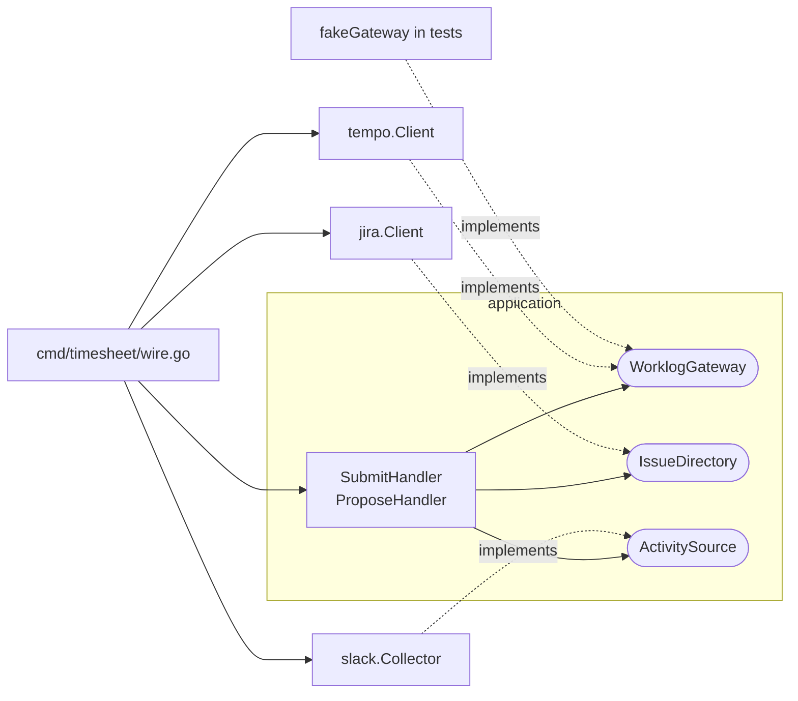

# Ports and adapters, and consumer-defined interfaces in Go

Written 2026-10-09. Read first: [Clean Architecture dependency rule](clean-architecture-dependency-rule.md). Next: [Idempotency and safe retries](idempotency-and-safe-retries.md).

## Short answer

**Ports and adapters**, also called hexagonal architecture, keeps the application at the centre and the outside world (Slack, Jira, Tempo, Postgres, tests) at the edges. A **port** is an interface that names one conversation the application needs, such as "write a worklog". An **adapter** is the code that holds that conversation with one real system, such as the Tempo HTTP client. In Go, the interface is normally declared by the package that **uses** it, not the package that implements it. That is why this repository's ports live in `timesheet/application/ports.go`.

Terms used on this page:

- **Interface (Go)**: a set of method signatures. Any type with those methods satisfies it automatically; there is no `implements` keyword.
- **Consumer**: the code that calls the methods (here, the application handlers).
- **Implementor / producer**: the code that provides the methods (here, the adapters).
- **Test double / fake**: a small hand-written implementation of a port used in tests instead of the real system.

## In this codebase

**The ports.** `ports.go` declares three interfaces, each with one method, in the application package that calls them:

```go
// ActivitySource provides the week's work evidence (Slack in production).
type ActivitySource interface {
	Collect(ctx context.Context, week kernel.WeekID) ([]kernel.WorkActivity, error)
}
```

```go
// IssueDirectory resolves issue keys to Jira issues.
type IssueDirectory interface {
	Resolve(ctx context.Context, key kernel.IssueKey) (Issue, error)
}
```

```go
// WorklogGateway writes worklogs to the time tracking system (Tempo).
type WorklogGateway interface {
	Create(ctx context.Context, w Worklog) (worklogID string, err error)
}
```

The handlers hold these as fields, for example `SubmitHandler.Gateway` ([`services/timesheet-core/internal/timesheet/application/submit.go:26`](../../../services/timesheet-core/internal/timesheet/application/submit.go#L26)). They never see Tempo, HTTP or JSON.

**The adapters.**

| Port | Adapter | Method |
|---|---|---|
| `WorklogGateway` | Tempo REST client | [`services/timesheet-core/internal/timesheet/infrastructure/tempo/client.go:50`](../../../services/timesheet-core/internal/timesheet/infrastructure/tempo/client.go#L50) |
| `IssueDirectory` | Jira REST client | [`services/timesheet-core/internal/timesheet/infrastructure/jira/client.go:43`](../../../services/timesheet-core/internal/timesheet/infrastructure/jira/client.go#L43) |
| `ActivitySource` | Slack search collector | [`services/timesheet-core/internal/activity/infrastructure/slack/collector.go:59`](../../../services/timesheet-core/internal/activity/infrastructure/slack/collector.go#L59) |

The Tempo adapter asks the compiler to confirm it fits the port: `var _ application.WorklogGateway = (*Client)(nil)` ([`services/timesheet-core/internal/timesheet/infrastructure/tempo/client.go:38`](../../../services/timesheet-core/internal/timesheet/infrastructure/tempo/client.go#L38)). If a method signature drifts, the build fails. Each adapter's constructor returns its concrete type, `*Client`, not the interface ([`services/timesheet-core/internal/timesheet/infrastructure/tempo/client.go:31`](../../../services/timesheet-core/internal/timesheet/infrastructure/tempo/client.go#L31)).

**Plugging them in** happens in one place, the composition root `buildApp` ([`services/timesheet-core/cmd/timesheet/wire.go:25`](../../../services/timesheet-core/cmd/timesheet/wire.go#L25)). Swapping Tempo for something else means changing `wire.go`, not a handler.

**Tests use fakes.** `fakeGateway` is a few lines that record what would have been sent to Tempo ([`services/timesheet-core/test/unit/timesheet/application/handlers_test.go:77`](../../../services/timesheet-core/test/unit/timesheet/application/handlers_test.go#L77)). This is Cockburn's point: the application can be "developed and tested in isolation from its eventual run-time devices and databases".

**The same idea inside an adapter.** The Slack collector consumes the Slack SDK, so it declares the one SDK method it needs as its own small interface, `Searcher` ([`services/timesheet-core/internal/activity/infrastructure/slack/collector.go:20-24`](../../../services/timesheet-core/internal/activity/infrastructure/slack/collector.go#L20-L24)). `NewCollectorWithSearcher` takes any `Searcher` ([`services/timesheet-core/internal/activity/infrastructure/slack/collector.go:42`](../../../services/timesheet-core/internal/activity/infrastructure/slack/collector.go#L42)), so its tests in `test/unit/adapters/slack/` can fake Slack. Both are exported because every test lives outside the package and sees only exported names ([ADR-0009](../../adr/0009-tests-in-separate-tree.md)).

**One port lives in the domain on purpose.** `Repository` is declared in `timesheet/domain` ([`services/timesheet-core/internal/timesheet/domain/repository.go:10`](../../../services/timesheet-core/internal/timesheet/domain/repository.go#L10)). The review lists this under "Deliberately fine, so do not fix" ([`docs/architecture/project-structure.md:189`](../../../docs/architecture/project-structure.md#L189)): it saves aggregates, so it speaks the domain's language.

## Why it matters

- **Testing**: every handler test runs in milliseconds with fakes. No Slack token, no Jira, no Tempo.
- **Change**: the planned allocation agent ([ADR-0007](../../adr/0007-grpc-contracts-now-split-later.md)) `[planned: P3]` is planned as a new adapter behind an existing port, `allocation.Policy`, wired in `wire.go`. The handlers that call the port stay the same.
- **The dependency rule**: the application imports only its own interfaces. Adapters import the application to see the port, so the arrows point inward. See [Clean Architecture dependency rule](clean-architecture-dependency-rule.md).

## Common mistakes in this repository (findings L7 and L6)

**L7: an interface defined on the implementor's side.** `internal/activity/domain` declares `Source` ([`services/timesheet-core/internal/activity/domain/source.go:11`](../../../services/timesheet-core/internal/activity/domain/source.go#L11)). It has the same method as `application.ActivitySource`. No consumer uses it; only the Slack adapter refers to it, to assert that it satisfies it ([`services/timesheet-core/internal/activity/infrastructure/slack/collector.go:46`](../../../services/timesheet-core/internal/activity/infrastructure/slack/collector.go#L46)). This is the pattern the Go wiki warns against: "Do not define interfaces on the implementor side of an API". The review recommends deleting `internal/activity/domain/` and moving the assertion to `wire.go` as `var _ application.ActivitySource = (*slackactivity.Collector)(nil)`, so it checks the interface that is actually used ([`docs/architecture/project-structure.md:175`](../../../docs/architecture/project-structure.md#L175)).

**L6: the port takes on the adapter's shape.** `Worklog` carries Tempo's formats: a start time as a `"HH:MM:SS"` string and a duration in seconds ([`services/timesheet-core/internal/timesheet/application/ports.go:36`](../../../services/timesheet-core/internal/timesheet/application/ports.go#L36)). The application builds that string itself ([`services/timesheet-core/internal/timesheet/application/submit.go:57`](../../../services/timesheet-core/internal/timesheet/application/submit.go#L57)). A port should speak the application's language, such as a `kernel.Duration` and a start minute, and the adapter should translate to the wire format. Otherwise a second time-tracking system would have to accept Tempo's format, or the port would have to change. The review records this as L6: "Slot rule and Tempo formats in the application port" ([`docs/architecture/project-structure.md:174`](../../../docs/architecture/project-structure.md#L174)).

## Picture



## Try it

1. Open `test/unit/timesheet/application/handlers_test.go`, find `fakeGateway`, and change its `Create` to return an error for one issue (in your head, or in a scratch copy). Which existing test already does this? (Hint: `failFor`.)
2. Run `go test ./test/unit/timesheet/application/` in `services/timesheet-core`. Note that no network or database is needed.
3. Write, on paper, the port you would add for "send the user a Slack direct message", and decide which package it belongs in.

## Check yourself

1. Where should the interface for "send a Slack direct message" be declared?
2. What does `var _ application.WorklogGateway = (*Client)(nil)` do at run time?
3. Why does `application` not import the `tempo` package, even though it needs Tempo?

<details>
<summary>Answers</summary>

1. In the package that calls it, most likely `timesheet/application` next to the other ports. It should not live in the Slack adapter package.
2. Nothing. It is a compile-time check: the build fails if `*Client` stops satisfying `WorklogGateway`. The `_` discards the value.
3. The dependency rule forbids application from importing infrastructure. The application declares `WorklogGateway`; `wire.go` creates a `tempo.Client` and passes it in.

</details>

## Go deeper

- Go Wiki, "Go Code Review Comments", section Interfaces: <https://go.dev/wiki/CodeReviewComments#interfaces>. VERIFIED 2026-10-09. Quotes checked against the live page: "Go interfaces generally belong in the package that uses values of the interface type, not the package that implements those values", "Do not define interfaces on the implementor side of an API", and "Do not define interfaces before they are used".
- Alistair Cockburn, "The Hexagonal (Ports & Adapters) Architecture" (original 2005 article): <https://alistair.cockburn.us/hexagonal-architecture/>. VERIFIED 2026-10-09. Intent: "Allow an application to equally be driven by users, programs, automated test or batch scripts, and to be developed and tested in isolation from its eventual run-time devices and databases." Also: "A port identifies a purposeful conversation."
