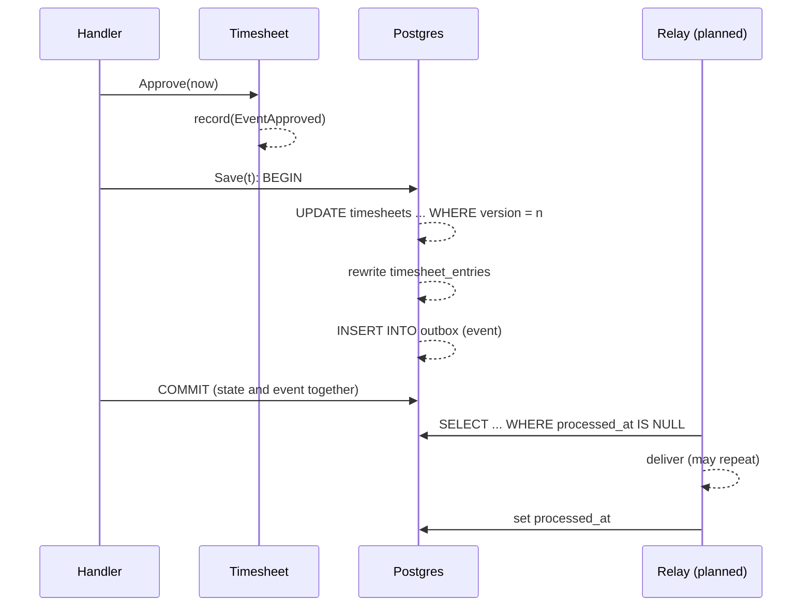

# Transactional outbox

Written 2026-10-09. Read first: [Aggregates and invariants](aggregates-invariants-and-zero-values.md), [Optimistic locking](optimistic-locking.md). Next: [Idempotency and safe retries](idempotency-and-safe-retries.md).

## Short answer

When a timesheet changes, other parts of the system need to hear about it. Later, for example, the Slack bot `[planned: P2]` will post "approved". The problem, in the words of microservices.io: "How to atomically update the database and send messages to a message broker?" The **transactional outbox** answers it. Write the message into an `outbox` table in the same database transaction as the change, so either both are saved or neither is. A separate process, the **relay**, later reads the table and delivers the messages.

Terms used on this page:

- **Transaction**: a group of database statements that succeed or fail together. `COMMIT` makes them permanent; `ROLLBACK` throws them all away.
- **Atomic**: all or nothing, with no half-done state visible.
- **Domain event**: a record that something happened in the domain, such as "timesheet proposed".
- **Message broker**: a service that passes messages between programs. This repository has none yet; the relay will deliver events directly.
- **Relay**: the background process that reads unprocessed outbox rows, delivers them, and marks them processed.

## In this codebase

**The aggregate records events.** Each state change calls `record`, which appends an `Event` to an in-memory list ([`services/timesheet-core/internal/timesheet/domain/timesheet.go:251`](../../../services/timesheet-core/internal/timesheet/domain/timesheet.go#L251)). `PullEvents` returns the list and empties it:

```go
func (t *Timesheet) PullEvents() []kernel.DomainEvent {
	evs := t.events
	t.events = nil
	return evs
}
```

**The table.** `00001_init.sql` creates `outbox` with `processed_at` and `attempts` columns for the relay, plus a partial index over unprocessed rows only:

```sql
CREATE TABLE outbox (
    id           bigserial PRIMARY KEY,
    aggregate_id text        NOT NULL,
    event_type   text        NOT NULL,
    payload      jsonb       NOT NULL,
    created_at   timestamptz NOT NULL DEFAULT now(),
    processed_at timestamptz,
    attempts     int         NOT NULL DEFAULT 0
);

CREATE INDEX outbox_unprocessed ON outbox (id) WHERE processed_at IS NULL;
```

**One transaction.** The Postgres repository's `Save` runs inside `pgx.BeginFunc` ([`services/timesheet-core/internal/timesheet/infrastructure/postgres/repository.go:88`](../../../services/timesheet-core/internal/timesheet/infrastructure/postgres/repository.go#L88)). In one transaction it updates the timesheet, rewrites its entries, and inserts the events:

```go
for _, ev := range t.PullEvents() {
	payload, err := json.Marshal(ev)
	if err != nil {
		return err
	}
	if _, err := tx.Exec(ctx, `INSERT INTO outbox (aggregate_id, event_type, payload) VALUES ($1, $2, $3)`,
		ev.AggregateID(), ev.EventName(), payload); err != nil {
		return fmt.Errorf("insert outbox: %w", err)
	}
}
t.SetVersion(next)
```

The pgx v5.11.0 source documents `BeginFunc` like this: "If fn does not return an error then it calls [Tx.Commit] on db. If fn returns an error it calls [Tx.Rollback] on db." So the `COMMIT` happens after the function above has returned.

**The decision** is [ADR-0002](../../adr/0002-postgres-with-transactional-outbox.md). The integration test `TestRoundTripConflictAndOutbox` expects exactly two outbox rows, "proposed" and "approved" ([`services/timesheet-core/test/integration/postgres/repository_test.go:110-116`](../../../services/timesheet-core/test/integration/postgres/repository_test.go#L110-L116)). The third save in that test fails on a version conflict and is rolled back, so its "rejected" event never reaches the table. That is the outbox working as intended.

**The relay is not built yet** `[planned: P2]`. It is planned for phase 2 under `internal/interfaces/outbox/` ([`docs/architecture/project-structure.md:68`](../../../docs/architecture/project-structure.md#L68)). Until then, rows are written and wait with `processed_at` empty.

## Why it matters

Without the outbox, `Save` would commit and then call Slack directly. If the process crashed between the two, the timesheet would be approved but no one would be told, and nothing would remember to try again. With the outbox, the event sits in the same commit as the change. A crash before the commit loses both; a crash after it keeps both, and the relay delivers the event later.

The other side of this: the relay may deliver an event and crash before marking it processed, and then deliver it again. microservices.io says it plainly: "The Message relay might publish a message more than once." Every event handler must therefore be idempotent. See [Idempotency and safe retries](idempotency-and-safe-retries.md).

## Common mistake: changing in-memory state before the commit succeeds (finding M5)

Recorded as M5: "Postgres `Save` drains events and bumps the version before commit; a failed commit loses events in a long-running process" ([`docs/architecture/project-structure.md:173`](../../../docs/architecture/project-structure.md#L173)).

Look at the excerpt above. Inside the transaction function, `t.PullEvents()` empties the aggregate's event list, and `t.SetVersion(next)` raises its version. Both happen before `BeginFunc` sends `COMMIT`. If the commit then fails, for example because the connection drops:

| Where | State after the failed commit |
|---|---|
| Database | Rolled back: old version, no new outbox rows |
| `Timesheet` object in memory | Events gone, version already `next` |

Today the CLI exits after one command, so the stale object is thrown away. The planned long-running processes, the Slack bot and the scheduler `[planned: P2]`, would keep it. Saving it again would then fail with `ErrConcurrentModification`, because the version no longer matches the row, and the events would never reach the outbox.

A fix in outline: read the events without clearing them, and only after `BeginFunc` returns `nil`, clear them and set the new version. The [SP-01 hardening plan](../../superpowers/plans/2026-10-09-sp01-hardening.md) (`status: draft`) plans this as "events kept until commit", in work packages WP-1 and WP-7.

## Picture



## Try it

1. Read `Save` in `internal/timesheet/infrastructure/postgres/repository.go` from top to bottom. Mark the line where the transaction starts, the lines that change the `Timesheet` object, and the point where `COMMIT` happens (hint: after the function returns).
2. If you have Docker: `docker compose up -d db`, then `make test-int` in `services/timesheet-core`. The repository test checks the outbox row count.

## Check yourself

1. Why not post to Slack directly inside `Save`?
2. What does the partial index `outbox_unprocessed` speed up?
3. The commit fails after the transaction function returned `nil`. What is in the database, and what is in the `Timesheet` object?

<details>
<summary>Answers</summary>

1. A network call cannot join the database transaction. If Slack succeeded and the commit then failed, or the other way round, the two would disagree. Writing the event to the outbox keeps it in the same commit as the change.
2. The relay's query for rows where `processed_at IS NULL`. The index contains only those rows, so it stays small as processed rows pile up.
3. The database has rolled back: old version, no new outbox rows. The object has already lost its events and has the new version number (finding M5).

</details>

## Go deeper

- Chris Richardson, "Pattern: Transactional outbox", microservices.io: <https://microservices.io/patterns/data/transactional-outbox.html>. VERIFIED 2026-10-09. Quotes checked against the live page: the problem "How to atomically update the database and send messages to a message broker?", the solution "first store the message in the database" and "A separate process then sends the messages to the message broker", and "The Message relay might publish a message more than once."
- pgx v5.11.0, `tx.go`, the doc comment on `BeginFunc`, read from the local Go module cache on 2026-10-09.
